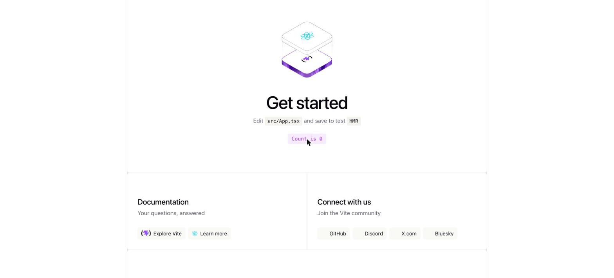

# AgentTab prototype: state before BCH BLAZE 2026

What existed before the hackathon began (Nov 14, 2026 14:00 UTC), built unchanged from commit
[`631e586`](https://github.com/Aakash074/agenttab-prototype/tree/631e586) (Nov 13, 19:28 UTC).
No hosted demo existed at the time; this branch was published on Nov 22 so judges can see the starting point.

**The web app at 631e586** was only the default Vite + React starter page; no wallet flow or UI had been built.
Its build is in [`app/`](app/) (live copy: https://raw.githack.com/Aakash074/agenttab-prototype/gh-pages/app/index.html).

**The covenant at 631e586:** [`AgentChannel.cash.txt`](AgentChannel.cash.txt), a voucher micropayment channel.

**Its 5 security tests**, run on a local mock (no chain): [`test-output.txt`](test-output.txt)
(overclaim, forged voucher, cross-channel voucher, owner shortchanged, valid settle: 5 passed).

Everything else (the AgentTab covenant with outpoint-bound vouchers and refund, the x402 paywall server, the MCP server,
the web app, chipnet and mainnet runs) was built during the hackathon in https://github.com/Aakash074/agenttab.
